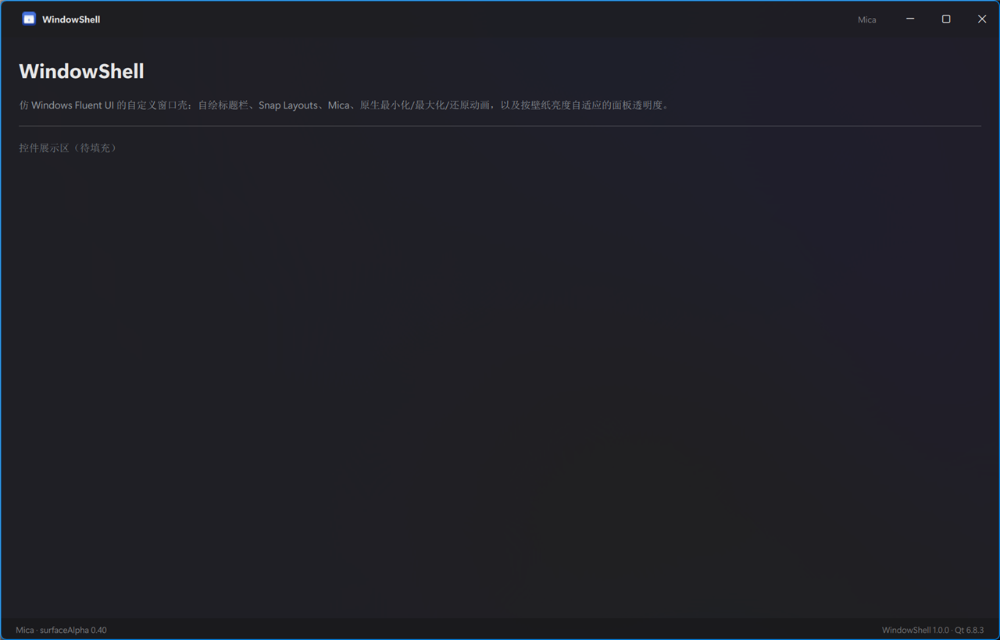

# WindowShell — Qt Fluent 窗口壳模板

一个**可以整体搬走**的 Windows 窗口壳：自绘标题栏 + Snap Layouts + Mica + 原生最小化/最大化/还原动画，
外加一组仿 Windows Fluent UI 的自绘控件。取自 [Bosun](https://github.com/Crequency/Bosun) 里实际
打磨过的那套壳，去掉了文件管理器业务。



## 特性

| | 说明 |
|---|---|
| 自绘标题栏 | frameless 窗口 + `WM_NCCALCSIZE` 让客户区覆盖整窗，标题栏完全自己画 |
| 原生 Snap Layouts | 保留 `WS_THICKFRAME` / `WS_MAXIMIZEBOX`，`WM_NCHITTEST` 返回 `HTMAXBUTTON` 让系统弹布局面板 |
| 原生窗口动画 | 保留 `WS_CAPTION`（不要 `WS_SYSMENU`，那是 DWM 画重复按钮的开关），系统才播过渡 |
| Mica | `DWMWA_SYSTEMBACKDROP_TYPE` + 分层窗口；面板透明度按壁纸平均亮度自适应 |
| 窗口装饰 | DWM 圆角、阴影、激活态强调色边框，最大化时自动切直角并去掉边框 |
| 关闭过渡 | 系统不给自绘窗口播关闭动画，QML 里 130ms 淡出后二次 close |
| 图标 | Fluent System Icons（MIT）字体 + 语义名映射，见 `components/Icons.qml` |

## 目录

```
WindowShell/
├── Main.qml                 窗口壳（标题栏 / 内容 / 状态栏 / 关闭淡出）
├── components/              自绘控件（CaptionButton / IconButton / Icons / AboutDialog ...）
├── pages/ControlsPage.qml   控件展示页
├── src/
│   ├── main.cpp             入口：装壳、下发 Mica、注入 context 属性
│   └── platform/
│       ├── window_chrome.*  frameless 窗口过程：NCCALCSIZE、NCHITTEST、caption 命中、动画
│       ├── mica_effect.*    DWM backdrop / 圆角 / 边框色
│       └── wallpaper_tone.* 壁纸平均亮度 → 面板 alpha
├── assets/                  字体与图标
└── docs/                    设计说明
```

## 构建

需要 Qt 6.8+（MinGW 或 MSVC 都行）、CMake 3.24+、Ninja。

```powershell
$env:QT_ROOT = 'C:/Qt/6.8.3/mingw_64'
cmake --preset debug
cmake --build --preset debug
.\build\debug\bin\WindowShell.exe
```

命令行开关：

- `--native-frame`：保留系统标题栏（对照用，排查窗口行为时非常有用）
- `--no-mica`：关闭 Mica，窗口退回不透明

## 把这些搬进你自己的项目

最小集是四个文件：

1. `src/platform/window_chrome.{h,cpp}` —— `enableSystemDecorations(window)` + `WindowChrome` QML 类型
2. `src/platform/mica_effect.{h,cpp}` —— `applySystemBackdrop(window)`
3. `src/platform/wallpaper_tone.{h,cpp}`（可选）—— 自适应 alpha
4. `components/CaptionButton.qml` + `components/Icons.qml`

接法见 `src/main.cpp` 与 `Main.qml`，注释里写清了每一步**为什么**不能省。

## 已知限制

- 只在 Windows 上有完整效果；其他平台 `window_chrome` / `mica_effect` 会干净地返回 false，
  窗口退回普通 Qt 窗口。
- Mica 需要 Windows 11 22621+；圆角/边框色需要 22000+。
- 标题栏高度 48 DIP 是硬约定：`WindowChrome` 的原生命中区与 QML 的按钮布局共用这个值，
  改的话两边要一起改。
- 壁纸亮度只在启动时算一次，换壁纸要重启才生效（换来的是一次加载、零运行时开销）。

## 致谢

- [Fluent System Icons](https://github.com/microsoft/fluentui-system-icons)（MIT），见 `assets/fonts/LICENSE-FluentSystemIcons.txt`
- 壳的打磨过程与踩过的坑记录在 `docs/design-notes.md`
