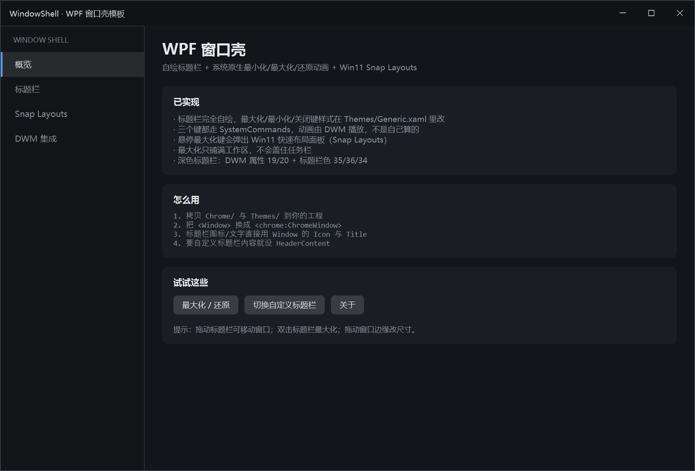

# WindowShell — WPF 窗口壳模板

一个**可以整体搬走**的 Windows 窗口壳：自绘标题栏 + 系统原生最小化/最大化/还原动画 + Win11 Snap Layouts。
取自 [Omnipivot](https://github.com/Dynesshely/Omnipivot) 里实际在用的那套壳，去掉了业务内容。



## 特性

| | 说明 |
|---|---|
| 自绘标题栏 | 无边框视觉，但**保留系统窗口样式**（WS_CAPTION / WS_THICKFRAME），靠 WindowChrome 把非客户区画没 |
| 原生窗口动画 | 三个键全部走 SystemCommands.MinimizeWindow / MaximizeWindow / RestoreWindow，动画由 DWM 播放，不是自己插值 |
| Snap Layouts | WM_NCHITTEST 在最大化键区域返回 HTMAXBUTTON，Win11 才会弹快速布局面板 |
| 最大化不盖任务栏 | WM_GETMINMAXINFO 按显示器**工作区**（rcWork）回填，而不是整块屏幕 |
| 深色标题栏 | DWM 属性 20 / 19（深色模式）+ 35 / 36 / 34（标题栏色、文字色、边框色） |
| 可换标题栏内容 | 设 HeaderContent 后整块替换左半边（图标 + 标题），右侧三大金刚键保持不动 |
| 主题化 | 标题栏高度 / 背景 / 前景 / 窗口边框色都是依赖属性，样式集中在 Themes/Generic.xaml |

## 目录

```
WindowShell/
├── src/WindowShell/
│   ├── Chrome/
│   │   ├── ChromeWindow.cs              窗口壳本体：WindowChrome、窗口消息、DWM
│   │   └── NullToVisibilityConverter.cs 标题栏内容切换用
│   ├── Themes/Generic.xaml              默认样式与 ControlTemplate（三大金刚键样式也在这里）
│   ├── MainWindow.xaml(.cs)             演示页
│   ├── App.xaml(.cs)
│   └── assets/app.ico
└── docs/
    ├── screenshot.png
    └── design-notes.md                  每个非常规写法的实测结论
```

## 构建

需要 .NET 8 SDK（dotnet --version ≥ 8.0）。

``` powershell
cd Wpf/WindowShell/src/WindowShell
dotnet build -c Release
.\bin\Release\net8.0-windows\WindowShell.exe
```

## 怎么用

1. 把 Chrome/ 与 Themes/ 两个目录拷到你的工程；
2. 把窗口的 Window 标签改成 chrome:ChromeWindow（xmlns:chrome="clr-namespace:你的命名空间.Chrome"）；
3. 标题栏图标与文字直接沿用 Window.Icon / Window.Title；
4. 要自定义标题栏左半边，设 HeaderContent（任意 object）。

``` xml
<chrome:ChromeWindow x:Class="Demo.MainWindow"
                     xmlns:chrome="clr-namespace:Demo.Chrome"
                     Title="我的应用" Icon="pack://application:,,,/assets/app.ico">
    <Grid>
        <!-- 你的内容，自动放在标题栏下方 -->
    </Grid>
</chrome:ChromeWindow>
```

## 可调属性

| 属性 | 默认 | 作用 |
|---|---|---|
| TitleBarHeight | 40 | 标题栏高度，**必须与 WindowChrome.CaptionHeight 一致** |
| TitleBarBackground | #B30F1216 | 标题栏底色 |
| TitleBarForeground | #D7DDE3 | 标题文字色 |
| WindowBorderBrush | #343A43 | 窗口 1px 边框（最大化时自动去掉） |
| HeaderContent | null | 替换标题栏左侧内容 |
| UseDarkTitleBar | true | 是否应用 DWM 深色标题栏 |

## 已知限制

- 只针对 Windows；Snap Layouts 需要 Windows 11（build 22000+），Win10 上其余功能正常。
- 窗口**不能**设 AllowsTransparency=True（会切分层窗口，动画与 Snap 全失效）。
- 背景不做 Mica/Acrylic —— 那属于另一套（DwmSetWindowAttribute 的 DWMWA_SYSTEMBACKDROP_TYPE），本模板只保留纯色/图片背景，避免和 WPF 渲染路径打架。
- 标题栏高度改了要同步改 CaptionHeight，否则拖动热区和视觉会错位。

## 致谢

取自 [Omnipivot](https://github.com/Dynesshely/Omnipivot)（RA3 日冕 Mod 助手）的窗口壳，行为在 Windows 11 上逐条实测过，结论记在 [docs/design-notes.md](docs/design-notes.md)。
